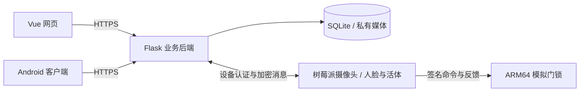

# 安居 · SmartLock

[](https://github.com/Bearono/smart_lock/actions/workflows/verify.yml)

智能门锁与门前摄像头系统。使用 Vue 网页和 Android 客户端访问同一业务后端，由树莓派完成实拍、人脸与活体检查，结合动态验证码授权开门；独立 ARM64 服务模拟锁舌执行并返回可追溯回执。

## 交付范围

当前交付包含网页、Android App、后端、树莓派摄像头服务和 ARM64 模拟门锁。手机端与网页端的真实人脸验证、验证码、开锁及上锁流程均已完成联调，详情见[验收范围](docs/acceptance.md)。

音频实验、实体锁具、整机重启自动恢复及长时间稳定性验收不在本次约定范围。模拟执行在界面和 API 中明确标识，不代表实体锁动作。课程实验与历史资料独立存放，不参与日常开门。

## 系统组成



| 路径 | 职责 |
| --- | --- |
| [apps/api](apps/api/README.md) | 账户、权限、MFA、私有媒体、命令与审计 |
| [apps/web](apps/web/README.md) | 网页界面、业务交互、响应式设计 |
| [apps/android](apps/android/README.md) | 手机客户端与独立 APK 构建 |
| [apps/device](apps/device/README.md) | 树莓派相机、识别、心跳与执行器适配 |
| [apps/lock_sim](apps/lock_sim/README.md) | 独立 ARM64 模拟执行服务 |
| [packages/smartlock_protocol](packages/smartlock_protocol/README.md) | 双端共享协议与密码实现 |
| [deploy](deploy/README.md) | 镜像、TLS、初始化、维护与验收工具 |
| [docs](docs/README.md) | 架构、开发规范、接口、安全与验收说明 |
| [examples](examples/README.md) | 不进入应用构建的实验和历史示例 |
| workspace.toml / manage.py | 工作区清单与跨平台命令入口 |

## 快速启动

需要 Python 3.12、Docker Desktop（Linux 容器）。首次运行前按[开发指南](docs/development.md)安装锁定依赖，从仓库根目录执行：

```sh
python deploy/init_secrets.py
python deploy/init_local_tls.py
docker compose -f compose.yaml -f compose.tls.yaml up -d --build --wait backend web tls
docker compose exec backend flask --app run create-admin --username operator
```

管理员密码交互输入，无默认账号或密码。浏览器访问 **https://localhost:8443**，按[部署手册](deploy/README.md)配置本机课程 CA，首次登录绑定身份验证器。

以上启动业务服务；完整演示还需要配置树莓派设备及[模拟门锁](apps/lock_sim/README.md)。手机通过 USB 转发连接本机服务的操作见 [Android 指南](apps/android/README.md)。运行环境、证书及设备身份由部署者提供，源码不携带个人模板、账号数据库或私钥。

## 开发与检查

```sh
python manage.py check
python manage.py verify --output releases/verification
python manage.py web-dev --port 5173
```

CI 分别检查仓库、后端、前端、Android、课程实验、容器及 amd64/arm64 设备镜像。源码发布包由清单生成，校验与验收源码匹配；构建产物、依赖、原始照片与运行数据不提交 Git。

- [架构与模块边界](docs/architecture.md) · [开发与测试](docs/development.md)
- [接口参考](docs/reference/api.md) · [安全基线](docs/security.md)
- [贡献约定](CONTRIBUTING.md) · [安全问题反馈](SECURITY.md)
- [历史资料](docs/archive/README.md)：仅供追溯，不能代表当前状态。
