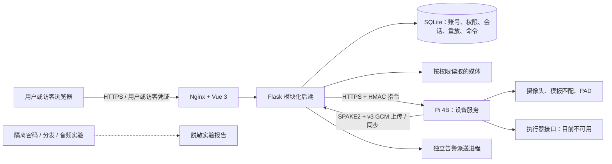

# 第三学期项目复盘建议

复核日期：2026-10-17。对象：智能家居终端安全系统——智能摄像头门锁。

## 1. 结论与本次操作

建议最后一学期围绕 **“可验证的设备身份与密钥生命周期、真实摄像头认证、可信执行结果”** 收束。现有业务已经足够丰富，继续添加大量页面或开锁方式的收益低于把现有链路做完整、测清楚。

本次已从 `https://github.com/Bearono/smart_lock` 获取 `develop`，在原目录切换到本地同名跟踪分支：

- 本地路径：`D:\term4\zongshe\smart_lock`。
- 旧成果基线：`main` / `15ad3f5fd3579395669552cc2016d0b1657d8939`，提交说明为上学期最新版，日期 2026-09-08。
- 新成果：`develop` / `743542bb3d75437edb32a8a6225913d13b789920`，最新提交日期 2026-10-11。
- `main` 是本次 `develop` 的祖先，新增 18 次提交。排除虚拟环境、缓存、node_modules 和前端依赖锁文件后，差异为 211 个文件、增加 16,324 行、删除 5,210 行。该统计只说明变动规模，不能换算成贡献质量或人员工时。
- 原有未提交文件《第三学期阶段性完善与密钥分发调研.md》保留，未覆盖。本次只新增复盘与组会材料，没有修改业务代码、提交或推送远程，也没有启动实际业务服务或连接树莓派。

用户最新确认：老师没有明确要求必须做实体锁、音频密钥传输或 Android；现有硬件为 Pi 4B / 2GB，赠送摄像头型号不清楚，实际图片人脸偏蓝；采购预算待组会确定。分支历史文档将摄像头记作 OV5647，这应当作为待现场核对的历史记录，不能代替当前硬件确认。

## 2. 前两学期已经做了什么

旧版 README、旧版源代码和 2026-07-02 答辩材料表明，前两学期已经具备：

- Flask 后端、Vue 2 前端、SQLite 数据库、树莓派设备网关和人脸检测/模板匹配。
- 注册审批、账号登录、TOTP、用户设备绑定、AuthSession、多因素开门流程。
- 一次性开门令牌、访客凭证、设备心跳、告警与操作记录。
- SPAKE2 + HKDF + AES-CBC/HMAC 的 v2 信封，以及 timestamp、request_id、nonce 防重放设计。
- 初步性能测试、安全场景测试和答辩材料。

所以不能把“添加 SPAKE2、添加 MFA、添加访客功能”整体当作本学期新成果。本学期的主要贡献是修正这些机制的安全边界、并发行为、部署方式和实际设备适配。

旧报告记载的 100 并发约 31.7 QPS、30 次端到端平均约 12.98 秒等数字属于旧版本、旧测试环境。当前源码没有经过同条件复测前，不宜宣称已经提升了多少倍。旧实验多类请求都约 2 秒，应重新分解网络、代理、设备派发、推理、事务等耗时，不能仅凭旧报告归因于 SQLite。

## 3. 这几周的主要完善

从提交历史可见的推进顺序如下。提交时间不等于全部开发发生时间，也不能用于估算个人工作量；这 18 次提交的作者字段均为 Taylor-Lai，实际协作分工仍需组会确认。

| 提交日期       | 可观察的重点                                                |
| ---------- | ----------------------------------------------------- |
| 9 月 11 日   | MFA 授权修复与设备绑定的开门令牌生命周期                                |
| 9 月 14 日   | 安全会话持久化与原子防重放                                         |
| 10 月 8～9 日 | 后端与设备交付基础、Vue 3 界面重构、v3 上下文绑定、跨架构 CI、完成度复核            |
| 10 月 11 日  | Pi 原生 CSI、主动拍摄、模板登记和单次授权记录、失败回执解释、课程密码/分发实验、PAD 与音频软件 |

### 3.1 登录与设备权限：把 MFA 变成真正的服务端门槛

旧版 `/login` 在密码正确后可以直接发 JWT，另有预登录 MFA 路线；新版将密码登录统一为临时挑战，TOTP 成功后才签发正式登录 JWT。登录挑战落数据库，并发消费和失败次数受到控制。待绑定认证器有有效期，历史待绑定秘密不能替换已经激活的认证器。

新增 `DeviceGrant`，明确区分“管理员授予设备访问权”和“用户绑定设备认证”。知道设备 ID 不能自行取得设备权限。新增账号版本与集中撤权逻辑，改密码、驳回账号、解绑、撤销设备授权等操作会使关联能力失效；重新批准或绑定不会复活旧授权。

关键代码：[auth.py](../apps/api/app/routes/auth.py)、[authenticators.py](../apps/api/app/authenticators.py)、[access_management.py](../apps/api/app/access_management.py)、[authorization.py](../apps/api/app/authorization.py)。

### 3.2 密钥交换与消息保护：从 v2 扩展到有上下文的 v3

当前设备通信流程为：每台设备预置独立秘密 → SPAKE2 → 绑定握手记录的 HKDF 派生 → 服务端证明、客户端确认及确认回执 → AES-256-GCM 业务信封。

主要改进包括：

1. 共享协议抽为 `packages/smartlock_protocol`，后端和设备复用同一源码，旧路径通过兼容入口转接，减少双端实现漂移。
2. v3 确认覆盖版本、双方握手数据、会话编号、随机数与有效期。未确认的会话不能提交业务；客户端拒绝协议降级。
3. AES-GCM 的关联数据绑定版本、设备、会话、消息编号、时间、nonce、HTTP 方法、端点和方向，降低跨接口挪用密文的风险。
4. nonce 在同一会话内通过加锁计数器生成；客户端重启重新握手，不恢复旧密钥并把计数器从零开始。
5. 服务端会话密钥加密入库，request_id 和 nonce 用数据库唯一约束仲裁，跨进程和服务重启后的防重放有测试。
6. 生产 Compose 关闭 v2，历史 ECC 上传默认关闭；超时不会自动重发业务，也不会自动退回旧协议。仅明确的“会话失效”允许重新握手一次。
7. 设备端收到的后端挑战/拍摄指令也校验 HMAC、时间及持久化 nonce；命令同步响应绑定原请求并校验认证。

关键代码：[v3.py](../packages/smartlock_protocol/smartlock_protocol/v3.py)、[security.py](../apps/api/app/routes/security.py)、[security_store.py](../apps/api/app/security_store.py)、[secure_payload.py](../apps/api/app/routes/secure_payload.py)、[command_guard.py](../apps/device/command_guard.py)。

这里应准确表述为“SPAKE2 协商共享会话密钥”，不是把会话密钥以明文发送，也不是双方凭空获得首次信任。首次设备秘密仍由维护者安全注入两端。项目使用 python-spake2 和自定义应用层 v3，不能据此声称完整通过标准兼容性或第三方安全认证。

### 3.3 开门链路：授权受理与真实执行分开

新版把一次性令牌绑定到具体设备，消费令牌与创建命令在同一事务中完成。新增 `DoorCommand`：命令 30 秒有效，有 pending、executed、failed、expired、revoked、superseded 等状态。

设备通过独立工作线程轮询，执行前持久化预约，避免重复/并发投递重复动作；崩溃后不盲目重做，回执可以独立重试。只有执行结果和反馈状态与目标匹配，才接受 executed。用户与访客页面会查询原命令，响应丢失时恢复原操作，避免重复消耗访客次数或重复开门。

关键代码：[lock.py](../apps/api/app/routes/lock.py)、[door_commands.py](../apps/api/app/door_commands.py)、[command_executor.py](../apps/device/command_executor.py)、[useDoorSession.ts](../apps/web/src/features/door/useDoorSession.ts)。

这是本学期很值得展示的工程改进：后台收到令牌、设备在线、HTTP 200，都不能作为实体门已经打开的证据。

### 3.4 摄像头与人脸：真实采集、受控模板和被动防伪

新增 Pi CSI/Picamera2 原生部署路线，保留 USB/V4L2 的设备容器路线。采集增加资源锁、异常恢复和退出释放；明确指定 CSI 时不悄悄退到别的视频节点。新增网页主动拍摄，与刷新已存画面区分。

模板工具支持登记、校验、列表、显式替换、删除；模型固定来源及哈希，生产运行不临时联网下载。采集、模板更新和推理有资源控制。

新增同帧 MiniFASNetV2 被动呈现攻击检测（PAD），生产后端要求身份相似度至少 0.90、防伪分数至少 0.80，并绑定设备、认证请求及 nonce。两个阈值是当前策略点，不代表 90%/80% 准确率，也不代表防照片攻击已验证。

关键代码：[camera_core.py](../apps/device/camera_core.py)、[manage_templates.py](../apps/device/manage_templates.py)、[anti_spoof.py](../apps/device/cv/code/anti_spoof.py)、[mfa.py](../apps/api/app/routes/mfa.py)。

### 3.5 隐私与产品界面

前端由 Vue 2 / Vue CLI 迁移为 Vue 3 / Vite / Vue Router 4，加入部分 TypeScript 契约；大页面拆为家门、动态、访客、设置与管理员功能。新增设备切换、离线/未知/失败状态、命令结果跟踪、响应过期隔离、小屏与文字放大适配。

媒体由公开路径改为授权读取，前端携带认证头获取图片，图片 URL 不携带 JWT。历史、媒体、设备状态按设备授权控制；设备派发地址由维护者登记，不能由设备自行上报任意目标地址。

主要价值是界面语义与后端事实一致，不应把新版主要成果仅归结为“美化页面”。

### 3.6 部署与维护

新增 Docker Compose、Nginx 同源代理、TLS/本地 CA 工具、非 root 与只读运行配置、健康/就绪检查、显式数据库初始化、依赖锁定、备份恢复与脱敏打包工具、持续集成和跨架构设备镜像检查。

默认管理员和通用密码已取消，改为维护者显式创建；设备独立口令加密保存。告警新增持久化通知队列、有限重试和失败状态；没有 SMTP 配置不代表邮件已发送。

电脑负责网页、后端与数据库，Pi 负责采集、识别、设备通信与未来执行器，适合目前 2GB 板子的资源条件。当前实机记录使用 SSH 隧道联调，仍依赖电脑和隧道运行。

### 3.7 密码与分发课程实验

新增 XXTEA、RSA-OAEP、ECDSA-P256、X25519/HKDF 原语实验，以及 KDC 票据、公钥封装加签名的分发对照。新增 OFDM/PCM 波形软件实验与 v3 信封适配器。

需要分清四个概念：

| 内容               | 解决的问题             | 当前边界                  |
| ---------------- | ----------------- | --------------------- |
| SPAKE2           | 基于预置秘密认证并协商会话密钥   | 已进入设备通信主线             |
| KDC              | 可信中心生成并向双方分发会话密钥  | 隔离、内存实验；中心知道密钥        |
| RSA-OAEP + ECDSA | 将会话密钥封装给接收方并验证发行者 | 隔离实验，依赖预置信任，无完整证书生命周期 |
| OFDM             | 把已有认证密文承载为音频波形    | 目前不打开声卡；不是声学实机或可信物理指纹 |

裸 X25519 一致性不提供对端身份认证；XXTEA 实验没有完整性保护；音频 CRC 不能认证身份。KDC 与公钥分发实验当前均不提供前向保密，实验重放状态也不是生产数据库服务。建议用于解释选择与对照，不把所有算法堆进开门主流程。

## 4. 当前架构及值得保留的设计

认证流程：账号密码和 TOTP 登录 → 服务端检查设备授权与绑定 → 签名人脸挑战 → Pi 采集并加密上报 → 后端校验身份/PAD/nonce/有效期及所需 TOTP → 签发设备绑定令牌 → 原子消费并排队 → Pi 执行/反馈 → 网页显示最终结果或未知。

建议保留模块化单体、SQLite、共享协议包和电脑/Pi 分工。没有实际容量瓶颈前，不引入微服务、消息集群或为了“高级”而迁移数据库。

## 5. 完成度应怎样表述

| 项目                         | 本次结论                       | 证据层级                 |
| -------------------------- | -------------------------- | -------------------- |
| 登录、设备权限、v3、并发防重放、命令与访客生命周期 | 有实现，本次隔离回归通过               | 本机重新验证的软件证据          |
| Vue 3 前端                   | 13 项业务测试、lint、类型检查、生产构建通过  | 本机重新验证；未重跑浏览器交互      |
| Pi 采集、签名拍摄、加密上传            | 分支文档记录已在 Pi 实测             | 历史设备记录，本次未连接硬件       |
| 本人人脸 + TOTP 授权             | 历史文档记载一次成功授权，最终执行因无驱动失败    | 单次历史记录；不能推广为识别率或开门成功 |
| PAD                        | 模型、服务端策略和测试已接入             | 真人/照片/屏幕攻击独立评测缺失     |
| 实体锁与门磁                     | 未接入；当前 UnavailableActuator | 不能声称实物开锁完成           |
| 音频分发                       | 本次 Windows 软件实验通过          | 没有声学硬件实测，也非本次已确认必做项  |
| Android、直播、双向语音、完整 OTA     | 不属于当前交付主线                  | 本次需求未要求，可保持延期        |
| 稳定性与恢复                     | 有工具和部分历史短时记录               | 最终版本长时运行、Pi 整机恢复待测   |

旧文档状态存在先后差异：README 尚有“没有活体检测算法”的旧表述，而最新代码已经接入被动 PAD；部分文档仍写音频暂缓，最新代码已具备软件实验。验收数字也有 85、102、108、113、114、134 等不同阶段。应选一个最终提交，集中维护一张状态表，不混用历史数字。

历史单次真实授权记录也不能直接证明启用最新 PAD 策略后的本人流程已通过；该版本需要重新做真人正向与攻击负向实测。

## 6. 本次发现的优先问题

### 6.1 偏蓝画面：先定位再决定买相机

旧 `main` 的 CameraManager 以 Picamera2 `RGB888` 采集，然后额外执行 `COLOR_RGB2BGR`；新版主服务已去掉转换。官方手册说明该格式的数组实际是 B、G、R 顺序，直接交给 OpenCV 才符合其预期。

但旧录入工具 `apps/device/cv/code/enroll_face.py` 的 `_Picamera2Camera.read()` 仍保留相同转换。如果继续用该脚本现场录脸，可能出现登记图像与主服务验证图像颜色不一致。新版运维说明主推 `manage_templates.py` 导入已采集图像，因此不能假定当前生产登记一定触发此问题。

建议一次排查任务在同一光线下拍白纸、红色物体和人脸，比较三个阶段：系统相机工具原图、项目采集保存图、网页显示图。记录传感器型号、相机库版本、像素格式、白平衡和实际运行的代码版本。

- 系统原图正常、项目图偏蓝：先检查红蓝互换、旧脚本和旧部署，统一为采集/传输 BGR、模型入口按需一次转 RGB；不得全局删除所有颜色转换。
- 系统原图也偏色：再检查白平衡、光照、镜头/排线和是否为 NoIR 模组。NoIR 可能影响日光颜色，但“偏蓝”本身不能确定其型号。
- 通道和白平衡修正后仍不可用，再替换标准彩色、有 IR-cut 的相机。先借一只已知正常的 USB UVC 相机做 A/B 验证通常更划算。
- 成像流程变化后重新登记模板，登记样本与评测样本分开；否则旧色偏模板可能继续影响结果。

依据：[Picamera2 官方手册](https://datasheets.raspberrypi.com/camera/picamera2-manual.pdf)、[官方 NoIR 说明](https://www.raspberrypi.com/products/pi-noir-camera-v2/)。

### 6.2 密钥管理：已有轮换，仍缺清晰的设备退役闭环

`provision-device` 已能替换设备秘密并删除旧安全会话、作废认证会话/令牌和待执行命令，不要再把“从零实现轮换”列为新任务。

现有 `DeviceProvisioning` 有 enabled，但未发现完整的独立设备停用/退役命令或接口，也没有凭据版本、轮换时间和专门的轮换审计字段。用户撤权与设备身份吊销不是同一件事。

建议补一个受控运维入口：停用设备 → 同一事务撤销安全会话和派生授权/待执行命令 → 新握手失败、旧会话请求失败 → 再启用也不恢复旧能力。增加 credential_version、created_at/rotated_at/revoked_at、操作者与原因，不展示秘密。轮换明确采用短维护窗口：后台替换、设备同步配置、重新握手验收；不要未经设计就承诺无缝双密钥轮换。

此外，应用 `SECRET_KEY` 当前同时用于加密设备登记秘密和会话密钥，直接更换会让已有登记不可解密；需写清备份恢复与重登记流程。当前平衡 SPAKE2 需要服务端持有可恢复的设备秘密，不能仅把它替换为普通密码哈希就认为协议仍然可用。

### 6.3 版本库仍带有历史敏感材料和环境

本次确认 Git 仍跟踪 `apps/api/backend_priv.pem` 和历史 `instance/smart_lock.db`，另有 6,813 个虚拟环境文件、152 个 __pycache__ 文件。新增忽略规则和脱敏打包不会自动移除已经跟踪的历史内容。

应在单独的清理变更中确认这些文件是否为测试材料、是否含真实凭据/人员数据；实际使用过的泄露凭据需要轮换。清理跟踪的虚拟环境、缓存、实例库和私人图像/模板，建立可复现依赖与私有数据目录。历史重写影响协作者，需先制定协调方案，不能在今晚直接强制改写共享分支。本次未读取或输出私钥/业务库内容。

### 6.4 跨平台格式检查

本机 core.autocrlf=true，标准 `format:check` 报 52 个文件；指定 `--end-of-line auto` 后检查通过。建议用 `.gitattributes` 和一致的格式规则统一换行。此问题不阻止本次构建，但不能把当前 Windows 的标准格式检查写成已经通过。本次未批量格式化源码。

## 7. 最后一学期要做什么

### P0：必须完成

1. **一条现场可复现的密钥主线。** 展示设备独立注册 → SPAKE2 双向确认 → v3 业务通信 → 轮换 → 停用/退役；每一步有提交、测试和脱敏记录。
2. **修正并统一摄像头与登记管线。** 优先解决偏蓝，明确当前型号/配置，再建立本人和非本人独立测试集。
3. **补齐生命周期与证据。** 完成设备退役操作、凭据版本与审计；复核轮换/退役对旧会话、令牌、访客关联能力、待执行命令的影响。
4. **在实际 PC ↔ Pi 上测协议。** 冷启动完整握手至少 30 次，记录成功数、中位/p95、消息大小；会话复用与新握手分开；应用层握手与 TLS/网络建连耗时标清边界。
5. **形成安全回归矩阵。** 错误身份/秘密、握手证明篡改、业务篡改、错误端点/方向、重复消息、超时、并发消费、后台重启、轮换和退役后旧能力，记录预期与实际；这些很多已有用例，重点补实机和生命周期证据。
6. **冻结一个能交付的版本。** 从清洁环境复现部署，最终版本运行和恢复实验、源码与报告绑定、秘密清理、演示脚本与录像。

### P1：建议增加的完整功能

- **实体锁最小闭环（预算允许时优先）。** 一把带真实状态反馈的教学锁、驱动、电源、门磁；实现 Actuator，验证授权、短脉冲开锁、锁反馈、门开合、重新落锁和故障。补上锁舌状态与门位置两个独立概念。
- **门未关提醒。** 只有接入门磁后才增加；例如开门后超过可配置时限仍未关则告警。不要根据命令目标推断门是否关好。
- **维护就绪与凭据状态摘要。** 在现有管理/证据入口内显示设备启停、凭据版本、最近轮换、TLS 有效期与最近握手结果，禁止展示密钥；不再另造一套控制台。
- **实测人脸/PAD。** 在获得同意后，建议至少 3 名登记者、2 名未登记者，跨光照/距离/角度留独立测试；照片、屏幕照片、录像各形成单独攻击组。样本不足时给出分子/分母与失败案例，不发布泛化准确率。阈值校准与最终评测分开。

如预算暂时无法支持实体锁，可以先交付“真实摄像头终端 + 设备密钥交换和生命周期 + 安全授权及明确的执行器缺失”，但应向老师确认这个边界是否符合预期。LED 演示可辅助说明，不能写成实体锁验收。

### P2：有余力再做

音频实机分发、Android、远程视频/录像、双向语音、Passkey、硬件安全芯片、OTA、额外边缘主机。老师未明确要求的情况下，本学期不宜同时启动这些方向。音频若成为课程重点，再从现有软件实验扩展到真实播放/录音，不重复开发另一套加密协议。

## 8. 硬件采购顺序

以下金额只是组内立项预留区间，不是实时报价或购买承诺。先盘点已有电源、线材、散热和可借用设备，再对具体型号询价。

| 优先级   | 物品与选型要求                                                  | 用途与决策                                     |
| ----- | -------------------------------------------------------- | ----------------------------------------- |
| 先排查   | 现有 Pi 4B、相机；借用已知正常的 UVC 相机；固定支架和普通白光补光                   | 先判定偏蓝来自代码、白平衡还是模组；现有 Pi 继续使用              |
| 建议一套  | 带开闭/锁舌反馈及手动应急机构的低压教学锁、3.3V 兼容的直流驱动、匹配独立电源、端子/保护件、小门板/固定件 | 实体演示总预留约 200–400 元；实际价格待询                 |
| 随锁补齐  | 门磁、按钮、LED/蜂鸣器及线材                                         | 门位置和锁状态独立；故障/超时可观察，尽量包含在上述整套预算            |
| 排查后选购 | 普通彩色 IR-cut UVC 相机，或标准彩色 CSI 相机和 Pi 4 兼容排线               | 只有现有模组修正后仍不可用再买；预留约 100–300 元，选接口后复核驱动与模型 |
| 缺才购买  | Pi 4 稳定电源、散热、可靠存储卡、网线                                    | 优先稳定联调；Pi 官方推荐 5V/3A 级供电，不能拿 GPIO 电源直接带锁  |
| 条件选做  | Linux 支持的 USB 音频输入/输出、麦克风和小扬声器                           | 仅在决定做音频实机后购；预留约 100–200 元，优先用电脑已有端作为发送端   |
| 暂不购买  | Pi 5/第二块 Pi、深度摄像头、NPU、TPM/安全芯片、大屏、成品联网门锁                 | 当前缺口主要是验收和外围闭环；第二身份可先用电脑独立进程实验            |

参考选型而非指定购买：DFRobot FIT0620 官方资料写明 9–12V、1.5A、带反馈，且通电应少于 5 秒。这说明驱动必须使用限时脉冲及独立电源，不能把 UNLOCKED 命令解释为持续通电。具体反馈是锁扣、触点还是其他机械状态，需要按手册和实物验证映射；read_state() 应读取可信信号，不能返回 GPIO 输出电平。

Pi GPIO 为 3.3V 逻辑，锁/继电器选择应核对输入阈值、负载与反馈电平；不可将 5V/12V 反馈直接接 GPIO。电气接线由硬件负责人按锁具手册确认。

来源：[锁具产品与通电限制](https://www.dfrobot.com/product-1856.html?search=fit0620)、[锁具规格](https://wiki.dfrobot.com/fit0620/)、[Pi GPIO 官方说明](https://www.raspberrypi.com/documentation/computers/raspberry-pi.html)、[Pi 4 供电资料](https://datasheets.raspberrypi.com/rpi4/raspberry-pi-4-datasheet.pdf)、[官方音频选型白皮书](https://pip-assets.raspberrypi.com/categories/1259-audio-camera-and-display/documents/RP-008124-WP-1-Choosing%20an%20Audio%20option.pdf)。

## 9. 未来六周安排

按第 8～13 周给出建议，课程实际截止日期由组会核对；若剩余时间更长，余下周数保留修复和答辩缓冲。

| 周次     | 工作与完成定义                                                          |
| ------ | ---------------------------------------------------------------- |
| 第 8 周  | 全员从同一 develop 跑通；一名非原开发者按文档部署成功；确认硬件型号并完成偏蓝分阶段定位；冻结功能范围、预算和任务负责人 |
| 第 9 周  | 完成设备退役、版本/审计和轮换操作说明；旧秘密/会话/令牌/待执行命令的负向验证可复现；锁具方案和接线确定            |
| 第 10 周 | PC ↔ Pi 完成密钥与安全消息实测；若采购通过，实现执行器和反馈，连续完成至少 20 次正常动作并记录所有失败        |
| 第 11 周 | 独立人脸/PAD 样本评测；协议与端到端耗时拆分；卡阻、断连、回执丢失、重复命令、门未关等故障用例                |
| 第 12 周 | 最终候选版至少 8 小时连续观察、设备整机正常重启及网络/后端恢复、备份恢复；记录环境、版本、全部失败及恢复时间         |
| 第 13 周 | 功能冻结，只修验收问题；清理发布包，复测并绑定源码版本；统一报告、PPT、8–10 分钟演示与备份录像              |

“连续运行通过”需对应同一最终版本。建议目标而非既有成绩：重复/篡改/越权实验均拒绝，撤销后旧能力不复活；正常动作给出成功次数和反馈；系统故障保持失败/未知，不产生无授权动作。性能先测基线再定可达目标，不预写漂亮数字。

## 10. 分工建议

按旧答辩材料的六个职责方向分配，不由 Git 作者推断真实贡献；今晚由各人认领当前任务。

| 方向      | 建议交付物                           | 协同关系                |
| ------- | ------------------------------- | ------------------- |
| 密码协议    | 密钥资产表、握手时序、生命周期策略、KDC/公钥对照与攻击用例 | 与后端共同签收撤销与轮换        |
| 后端/数据库一 | 设备退役、凭据版本、审计、原子失效               | 与密码负责人配对            |
| 后端/数据库二 | 端到端联调、故障恢复、性能和发布证据              | 与硬件负责人配对            |
| 硬件嵌入式   | 相机确认、驱动/供电/反馈、门磁与实机运行           | 与 CV 共查偏蓝，与后端验收回执   |
| CV      | 同一采集与登记流程、模板维护、本人/负样本/PAD 实测    | 与硬件共同确认颜色与光照        |
| 前端/材料   | 在现有页面补可信状态/维护信息，统一图表、演示与交付索引    | 与全员核对“已实现/已测试/实机通过” |

每项任务写清主负责人、配合人、截止时间、验收步骤和证据位置。每周一次集成，至少安排一位非作者复现，避免成果只在某位同学电脑上可用。

## 11. 今晚组会该形成的决定

建议 60 分钟，具体议程见 [今晚组会提纲](MEETING_AGENDA_20261017.md)。必须形成：

1. 一句统一的项目目标，以及明确的必做/选做/延期清单。
2. 先交付安全摄像头终端、还是增加实体锁闭环；由谁向老师确认验收边界。
3. 相机偏蓝的负责人和 48 小时内的定位结果；采购在定位后决定。
4. 设备退役、密钥审计和实机实验的负责人、日期及完成定义。
5. 最低硬件清单、预算上限、询价人和购买节点。
6. 统一集成环境、开发分支、下一次演示日期及最终功能冻结时间。

建议现场演示：登录 MFA → 真实拍摄 → 正常设备握手/消息 → 重放拒绝 → 轮换后旧设备失败 → 设备退役后旧会话失败。没有锁具时如实显示执行器不可用；接入后再展示真实反馈。

## 12. 本次重新验证记录

环境：Windows、Python 3.12.8 独立 `.venv-review`、仓库锁定的后端依赖、NumPy 2.2.4；Node 24.14.0，前端按锁文件重新安装。协议源码通过 PYTHONPATH 加载共享包。

| 检查                            | 结果                  |
| ----------------------------- | ------------------- |
| 后端隔离回归                        | 134/134，通过；约 33.3 秒 |
| 前端业务单元测试                      | 13/13，通过            |
| 前端 lint / typecheck / build   | 通过                  |
| 标准 format:check               | 未通过；52 个文件的换行符差异    |
| 保持源码不变，使用 end-of-line auto 检查 | 通过                  |
| 原语、KDC/公钥分发、音频软件实验            | 三个报告均 passed=true   |
| Pi/实体锁/真实声学/浏览器/新容器部署         | 本次未重新验收             |

音频实验中 582 字节包对应约 0.507 秒波形，指生成波形时长，不是实测房间传输延时。所有新日志/脱敏 JSON 存于 `releases/review-20261017/`；初次使用旧依赖与受限环境产生的失败日志也保留，最终软件结论依据新版 Python 3.12 复核日志。

测试使用临时数据库与本机隔离 HTTP 服务，没有把测试账户写入原实例库，没有实际邮件或硬件操作。回归通过不等同于没有漏洞或完成实机验收。

## 13. 参考资料与命名修正

- [SPAKE2：RFC 9382](https://www.rfc-editor.org/rfc/rfc9382.html)。
- [SPAKE2+：RFC 9383](https://www.rfc-editor.org/rfc/rfc9383)。二者不同；原调研引用 SPAKE2+ 不能直接证明本项目实现 SPAKE2+。
- [当前架构与威胁模型](COURSE_ARCHITECTURE.md)、[课程密码实验与边界](COURSE_CRYPTO_LAB.md)、[PAD/音频最新记录](PAD_AUDIO_ACCEPTANCE.md)。
- [设备执行契约](DEVICE_EXECUTION.md)、[Pi 历史记录](archive/PI_INTEGRATION_20261010.md)、[课程最终交付手册](COURSE_FINAL_DELIVERY.md)、[部署说明](../deploy/README.md)。

外部硬件/标准资料在 2026-10-17 查询；具体产品库存与人民币成交价没有确认。本复盘按代码、历史文档及本次测试区分证据，没有替老师定义评分标准。
