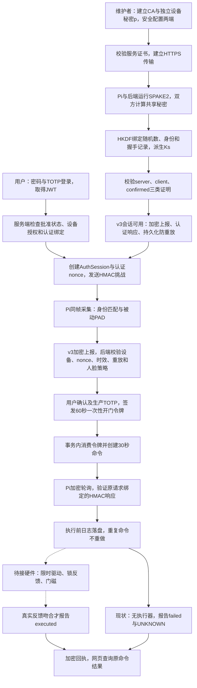
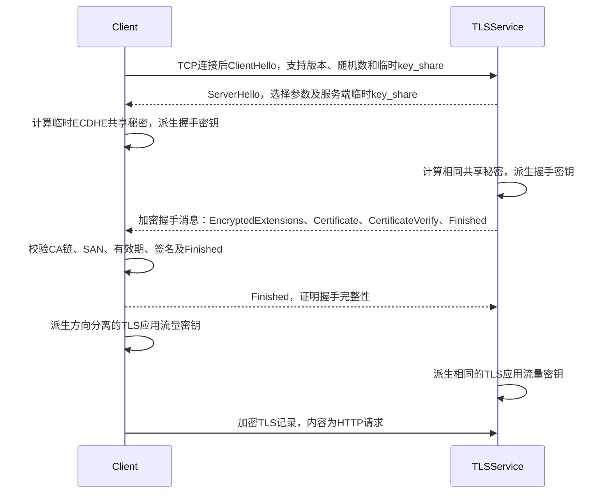
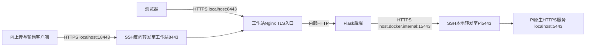
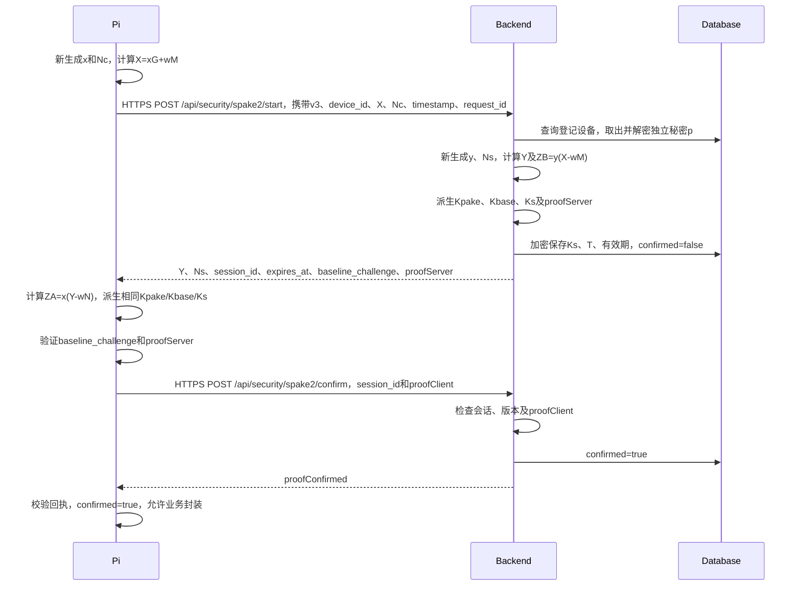
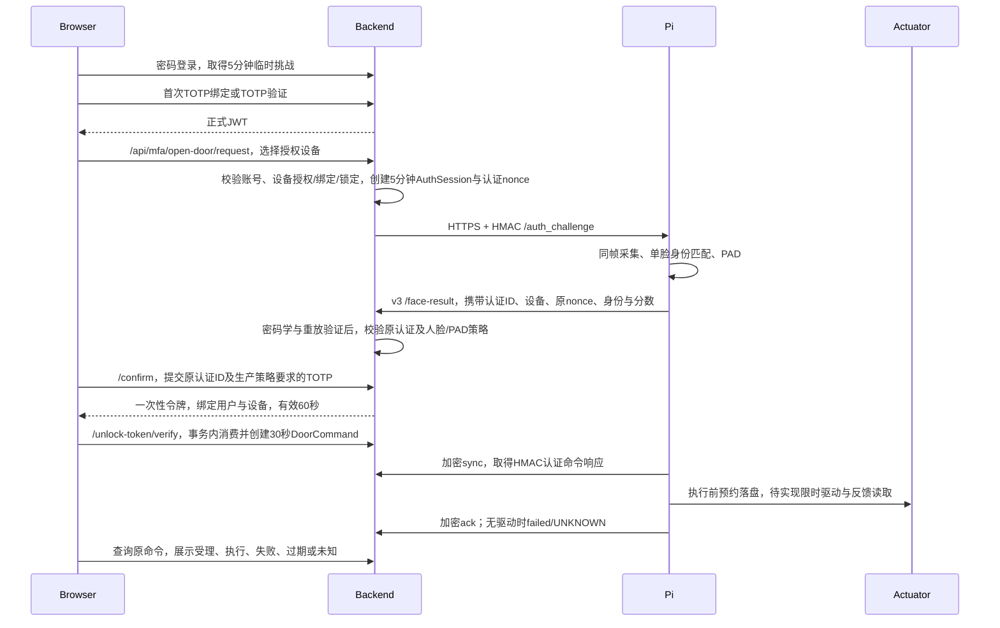

# 安全流程展示与逐步讲解

依据：develop / 743542b，2026-10-17 复核。本文解释现有实现，不代表重新完成硬件验收。

[可编辑流程图：三张图在同一 FigJam 中](https://www.figma.com/board/E0ep1WkE4QGzFISmGt4og1)

配套材料：[任务拆解](SECURITY_TASK_BREAKDOWN_20261017.md)、[硬件购买建议](HARDWARE_BUYING_GUIDE_20261017.md)。

## 1. 先统一名称和安全目标

**当前代码实现的是 SPAKE2，不是 SPAKE2+。** 它调用 python-spake2 0.9 的 SPAKE2_A / SPAKE2_B，默认使用 Ed25519 素数阶子群上的运算。其上叠加项目自定义的 v3 握手确认、HKDF 和 AES-GCM 消息协议。库和项目封装不能直接称为 RFC 9382 的完整互操作实现。

SPAKE2 需要两端都能取得同一设备秘密；SPAKE2+ 是增强型 PAKE，服务端注册材料为 w0 和 L=w1G 等验证记录，流程不同。增加 HMAC、升级 AES-GCM 或给版本号加 v3，都不会把 SPAKE2 变成 SPAKE2+。如果这里的“SPAKE+”只是泛指口令认证密钥交换，组会上请使用代码中的准确名称。

应回答的四个问题：

1. 连接到的服务是谁？——CA 及服务证书校验。
2. 请求来自哪台登记设备？——每设备独立秘密、SPAKE2、密钥确认。
3. 这条消息是否被改过、是否过期或重复？——GCM/HMAC、上下文绑定、时间与数据库重放仲裁。
4. 这个用户此刻是否获准操作，而且硬件是否真的执行？——用户 MFA、设备授权、一次性令牌、短期命令、执行日志及传感器反馈。

前两项不能替代用户授权，最后一项也不能只看 HTTP 状态码。

设备握手证明对方持有设备秘密，不证明Pi未被攻破，也不能独立证明人脸分数或传感器读数来自真实硬件。当前系统信任Pi诚实采集和执行；若Pi或p被控制，网络GCM本身不能阻止伪造设备证据。TOTP、设备退役、文件保护和真实故障评测仍各有作用，不能将其表述为已经完成硬件远程证明。

## 2. 一张总流程图

实线表示已有软件路径；虚线表示当前尚需接入的物理执行路径。图按启用 TLS 的部署方式说明；默认 localhost:8080 HTTP 只是本机预览入口，不能当作已自动启用 HTTPS。



设备握手通常由后台心跳、命令轮询或首次上传触发，不要求每次开门重新握手。图是依赖关系，不代表程序只在点击开门后启动所有步骤。

## 3. 首次信任怎样建立

首次登记依靠维护者可信配置，而不是让陌生设备自行报一个 ID 就自动被信任。

| 材料 | 谁持有 | 生成/配置方式 | 用途 |
| --- | --- | --- | --- |
| 本地 CA 私钥 | 维护主机受控目录 | 本地实验CA工具；远程产品可用正常证书体系 | 签发服务证书，不交给浏览器/Pi作为日常材料 |
| CA 公证书 | 浏览器信任库、后端、Pi | 经可信途径分发并核对 | 校验服务证书；公证书不是秘密 |
| 后端服务证书与私钥 | 工作站TLS入口 | CA签发，SAN匹配实际访问地址 | 后端HTTPS服务身份 |
| Pi服务证书与私钥 | Pi原生服务或设备TLS代理 | 独立签发，SAN覆盖实际访问名 | 后端连接Pi时验证其HTTPS服务身份 |
| 独立设备秘密 p | 对应Pi、后端加密登记表 | 随机生成后安全写入两端，至少32字节输入要求 | SPAKE2与设备指令HMAC，不复用登录密码 |
| SECRET_KEY | 后端秘密文件 | 持久随机值 | 派生存储保护密钥，加密设备秘密及会话密钥 |
| JWT_SECRET_KEY | 后端独立秘密文件 | 与SECRET_KEY不同 | 登录JWT签发/验证 |
| TOTP秘密 | 认证器与后端凭证记录 | 首次绑定生成 | 用户持有因子；不是Pi设备秘密 |
| 人脸模板 | Pi私有目录 | 本人同意、可信登记、模板校验 | 身份匹配；不是通信用密钥 |

推荐实际生成32字节随机值并用hex/base64编码保存；“字符串长度至少32字节”只是现有输入检查，本身不能证明随机性。明文设备秘密不要出现在截图、Git、普通审计日志或公开报告中。

`provision-device` 登记设备ID、加密秘密及服务地址；`grant-device` 单独授予用户访问权。设备身份登记、用户设备授权和用户认证绑定是三个不同步骤。

当前设备登记秘密和安全会话密钥有应用级加密；TOTP种子仍在`MFACredential.credential_data`中以可恢复文本保存，不能把整张数据库描述成“所有敏感字段均已加密”。应在凭据保护任务中单独设计TOTP静态保护与恢复，避免数据库、备份及主密钥同时暴露。

## 4. 通信信道怎样建立

### 4.1 三条应用通信路径

| 发起方 → 服务方 | 传输保护 | 应用认证 | 当前作用 |
| --- | --- | --- | --- |
| 浏览器 → 后端 | HTTPS | 登录后JWT，开门时另有一次性令牌 | 登录、用户授权、查询私有媒体、控制流程 |
| Pi → 后端 | HTTPS，Pi验证后端证书 | SPAKE2建立会话；上行v3 AES-GCM | 心跳、人脸证据、加密上传、sync及ack |
| 后端 → Pi | 独立HTTPS，后端验证Pi服务证书 | 独立设备秘密派生的HMAC | auth_challenge、主动拍摄等设备POST |

**当前没有启用 mTLS 客户端证书认证。** Pi提供的证书是“Pi作为HTTPS服务方”的证书；Pi作为客户端访问后端时，设备身份依靠SPAKE2。两个方向各有服务证书，不等于同一次TLS握手使用双向证书。

Nginx配置目前允许TLS 1.2和1.3，不能在答辩中声称代码已经强制TLS 1.3。生产登记接口目前仍接受http或https地址，图中的后端→Pi HTTPS是应选用的安全部署路径，后续应补生产强制校验。

### 4.2 TLS 1.3完整握手示意

这是为讲解信道机制给出的标准完整握手示例，不是宣称本次实测抓到了这些消息；TLS版本和套件实际由TLS库协商。现有设备凭据p不参与TLS密钥派生，代码没有配置TLS-PSK。



TLS库完成这些运算；不要自己在业务代码里实现TLS。已信任CA不代表忽略SAN或有效期；不能用verify=False解决证书错误。浏览器首次信任本地实验CA需要明确配置，不能假定自动受信。

TLS在工作站Nginx处终止，Nginx到Flask是内部HTTP；原生Pi则由带证书的Gunicorn终止TLS。工作站和后端可解密业务内容，本系统不是“后端不可见”的端到端加密。

### 4.3 当前SSH联调拓扑



SSH连接由工作站的`pi_tunnel.py`创建并核对主机密钥；它负责转发可达性，里面仍传HTTPS，证书SAN按实际访问名校验。它是受控联调拓扑，不是以后必须一直使用的产品网络结构。隧道关闭会中断两方向通信。

当前传输代码使用独立`requests.post`调用，没有显式共享requests.Session连接池；应用SPAKE2会话可以跨多个HTTP/TLS连接复用，不能把它画成一条始终不关闭的TCP/WebSocket。后续是否复用HTTPS连接，需先测连接成本。

## 5. SPAKE2究竟交换了什么

### 5.1 图中符号

- A：Pi；B：后端。idA=device_id，idB=字节串smart-lock-backend。
- p：该设备独立长期秘密；双方已通过首次登记拥有。
- G：群基点；M、N：库中确定的公开掩码点，其相对G的离散对数应未知；这些不是每次互传的秘密。
- w：库将p映射到群标量的结果。
- x、y：本次握手各自新生成的随机临时标量，不发送。
- X、Y：经过口令掩码的群元素，可以交换。
- Nc、Ns：应用额外生成的16字节客户端/服务端随机数。

### 5.2 群运算细节

下面对应当前库的加法群运行逻辑；不是RFC测试向量的线缆编码规范：

```text
双方：w = password_to_scalar(p)
Pi：  随机x，X = xG + wM
后端：随机y，Y = yG + wN

Pi收到Y：  ZA = x(Y - wN) = xyG
后端收到X：ZB = y(X - wM) = xyG

ZA与ZB应相同，但不会作为明文在网络发送。
```

库默认`password_to_scalar`为HKDF-SHA256扩展48字节（salt为空，info为`SPAKE2 pw`）后转整数模群阶。这里不是另加一个PBKDF2/Argon2操作；不能在讲图时虚构现有代码没有的密码预处理。项目使用随机设备秘密，仍应保持每设备独立和足够熵。

库输出握手消息带A/B角色字节和编码群点，应用再base64编码。JSON历史字段`client_pub`、`server_pub`中装的是SPAKE2消息，不能把它们描述成长期设备公钥或直接称为X25519公钥。

### 5.3 密钥派生与确认时序



当前代码的派生步骤如下，所有HKDF均为SHA-256，默认输出32字节；H表示SHA-256，CJSON为规范化JSON：

```text
Kpake = H(H(p) || H(idA) || H(idB) || encode(X) || encode(Y) || encode(Z))

Kbase = HKDF(Kpake,
             salt=Nc || Ns || UTF8(device_id),
             info="smart-lock-spake2-session")

T = CJSON({start: 完整start消息,
           reply: {version, session_id, server_pub, server_nonce, expires_at}})

Ks = HKDF(Kbase, salt=H(T), info="SL-SEC-v3/session")

Kconfirm(role) = HKDF(Ks, salt="SL-SEC-v3", info="confirmation/" || role)
proof(role) = Base64(HMAC-SHA256(Kconfirm(role), T))
role依次使用server、client、confirmed。
```

第一行是python-spake2库的完成哈希，后续是项目封装。基础challenge则用Kbase对session_id、device_id和双方随机数的规范JSON作HMAC；客户端先验证它，再验证绑定v3握手记录的proofServer。

**网络传的是X/Y、随机数、会话元数据和证明，不传p、x、y、Z、Ks。** 密码不匹配时不能得到匹配的确认值。proofServer让Pi验证后端确实得到密钥；proofClient让后端验证Pi；proofConfirmed让Pi确认后端接受了其确认。服务端只有confirmed=true的会话才能进入业务。

应用会话默认300秒。Pi一般在剩余不足10秒时为后续发送重新握手。握手不是每条消息执行一次，nonce也不是每次握手都重用同一值。

## 6. 业务消息怎样受到保护

### 6.1 Pi → 后端：AES-256-GCM

```text
Kup = HKDF(Ks, salt="SL-SEC-v3", info="AES-256-GCM/device-to-server")
nonce = 本会话加锁计数器，编码为12字节大端整数

header = {version, session_id, device_id, request_id,
          timestamp, nonce, endpoint, method, direction}
AAD = CJSON(header)
plaintext = CJSON(业务字段)
ciphertext_and_tag = AES-GCM.encrypt(Kup, nonce, plaintext, AAD)
packet = {header, Base64(ciphertext_and_tag)}
```

GCM认证标签随密文一起返回，头部受完整性保护但在应用封装中不加密，网络上的整体HTTP仍由TLS加密。头部不要当作可以随意记录秘密的区域；兼容接口的可选unlock_token字段若使用，仍需脱敏。

同一Kup下nonce必须唯一，重启Pi后重新握手获取新密钥，不能恢复旧密钥并把计数器归零。当前单会话最多允许2^32条消息。

后端接收顺序：

1. 检查格式、时间偏差（最多约120秒）、会话存在/未过期/已确认及协议版本。
2. 检查头部会话、设备、路径、方法和方向；GCM验证AAD/标签并解密。
3. 检查业务对象及设备身份，避免业务字段伪装为另一设备。
4. 在独立事务中登记`(session_id, request_id)`与`(session_id, nonce)`，由数据库唯一约束拒绝重复；登记保留至会话密钥生命周期结束。
5. 再进入业务权限、认证nonce、令牌等检查。一个通过密码学验证、但业务失败的信封仍会被消耗，不能靠业务回滚反复重放。

### 6.2 后端 → Pi：两种不同的认证

**主动挑战/拍摄命令：**

```text
Kcommand = H("smart-lock-backend-command\0" || UTF8(p))
message = JSON(["POST", path, timestamp, command_nonce, H(raw_body)])
MAC = HMAC-SHA256(Kcommand, message)
```

设备校验X-Command-Time、X-Command-Nonce、X-Command-Signature；要求约60秒时间窗口，nonce写入设备本地commands.db防重放。虽然头部名叫Signature，实质是共享秘密HMAC，不是ECDSA签名，不提供不可否认性。其保密性来自HTTPS；该命令密钥不随每次SPAKE2会话变化，需要轮换p才能更换。

**Pi轮询sync的响应：**

```text
Kresponse = HKDF(Ks, salt="SL-SEC-v3", info="HMAC-SHA256/server-to-device")
MAC = HMAC-SHA256(Kresponse,
                 CJSON({原请求header, endpoint, direction="server-to-device", body}))
```

Pi验证响应和原请求绑定，不能把别次轮询响应挪过来。响应body不是GCM密文，保密仍依赖HTTPS。不能把图讲成“所有双向消息都用同一把AES密钥加密”。

### 6.3 几种nonce与编号必须分清

| 名称 | 形式 | 用途 |
| --- | --- | --- |
| Nc/Ns | 各16随机字节 | 每次握手派生新会话 |
| GCM nonce | 12字节计数器 | 同会话加密唯一性与传输防重放 |
| AuthSession.nonce | 32随机字节的hex文本 | 将人脸结果绑定本次用户开门挑战 |
| X-Command-Nonce | 16随机字节的hex文本 | 后端主动POST指令防重放 |
| header.request_id | 每个信封新消息ID | 传输层应用去重 |
| 人脸业务request_id | 用户认证会话ID | 关联同一次人脸/确认/授权 |
| DoorCommand.id | 实际动作命令ID | 执行去重、回执、结果恢复 |

它们可以同时存在。人脸业务里的request_id和信封header.request_id不是同一个编号。

## 7. 用户认证、开门和回执



生产当前要求身份相似度≥0.90、PAD分数≥0.80并完成TOTP。相似度与PAD阈值不是准确率。图里的Actuator是待接硬件边界；当前gunicorn配置固定构造UnavailableActuator。

`executed`应当仅表示“本条命令执行时观测状态与目标匹配”，不是门永远处于该状态。锁舌反馈与门磁分别回答“锁是否到位”和“门是否关上”，两者不能混用。

访客路径使用带期限与次数预算的访客凭证，验证成功后生成设备绑定的一次性授权，后续进入同一命令和回执路径；访客并不经过本人人脸/TOTP流程。上锁操作也不走与开锁完全相同的因子要求，图展示的是普通用户的生产开门主线。

## 8. 轮换、退役和故障时怎样处理

| 事件 | 当前行为 / 必须明确的边界 |
| --- | --- |
| 应用会话到期或服务明确返回SECURITY_SESSION_INVALID | 设备重新握手一次，以新信封发送；不降级 |
| 网络超时、回执未知、一般业务错误 | 不自动重做开门业务；查询原命令，保留未知 |
| 后端正常重启 | 固定SECRET_KEY和数据库使会话/重放记录可恢复 |
| Pi重启 | 创建新SPAKE2会话；保留命令执行日志，不重复已预约动作 |
| 修改设备秘密 | 已有CLI可使旧会话、认证会话、令牌与待执行命令失效；Pi须同步新秘密 |
| 撤销某用户设备权限 | 影响该用户派生能力，与设备身份退役不同 |
| 退役整台设备 | 尚需补完整操作入口、版本及审计，并级联撤销旧能力 |
| 命令已经下发或物理动作已开始 | 后台撤销不能收回已发生动作；需明确执行许可与撤销的时间边界 |
| SECRET_KEY轮换 | 不仅影响会话，也会使加密登记秘密不可读；需专门重加密/重登记或维护恢复方案 |

不得承诺分布式网络上“按下撤销按钮就瞬间停止一切物理动作”。现有30秒命令和后端下发前检查缩小风险窗口，但已取出的命令仍需制定执行前校验/短租约或可说明的撤销语义。

## 9. 若老师专门问SPAKE2+

这是可讲解的对照，不是当前系统流程：

```text
注册阶段：客户端从密码派生w0、w1；服务端保存w0和L=w1G。
交换阶段：X=xG+w0M，Y=yG+w0N。
客户端：Z=x(Y-w0N)，V=w1(Y-w0N)。
服务端：Z=y(X-w0M)，V=yL。
双方再将身份、交换消息、Z/V等绑定到规范transcript，派生并确认密钥。
```

SPAKE2+的增强注册材料减少服务端对原始口令的直接依赖，但不消除可信注册、服务端材料保护及在线猜测限制。要迁移必须重新设计注册格式、选择维护中的实现、通过RFC测试向量及负向用例，不能只改一个类名或数据库列。本学期优先讲透并验证现有主线，除非老师明确要求，否则不建议此刻更换协议。

## 10. 组会上可以按这六句话讲

1. 首次由维护者把独立设备秘密和CA信任安全地放入两端，解决“最初相信谁”。
2. 每次建立HTTPS时校验证书，TLS提供加密传输；它与应用设备秘密分开。
3. SPAKE2交换掩码群点，双方本地算出同一秘密，经过HKDF与双向确认后启用短会话。
4. 上报使用GCM，主动下发和同步响应使用相应HMAC，数据库和设备日志共同处理重放。
5. 用户身份、设备身份和开门授权分别验证，令牌消费只表示创建了短期命令。
6. 设备执行前去重落盘，真实传感器反馈才支撑成功；当前无锁驱动，所以最终应明确失败或未知。

## 11. 代码与资料索引

| 内容 | 代码 |
| --- | --- |
| SPAKE2群运算与完成哈希 | BE_smart_lock/smart_lock/spake2/spake2.py、groups.py、ed25519_group.py |
| 握手消息与基础派生 | packages/smartlock_protocol/smartlock_protocol/v2.py、后端routes/security.py |
| v3确认、GCM、nonce | packages/smartlock_protocol/smartlock_protocol/v3.py |
| 会话入库及原子重放登记 | app/security_store.py、app/routes/secure_payload.py |
| 主动POST命令HMAC | app/device_commands.py、paspberry_pi/command_guard.py |
| 网络建立与恢复 | paspberry_pi/transmit.py、deploy/pi_tunnel.py、deploy/nginx.tls.conf |
| 人脸与授权 | app/routes/mfa.py、paspberry_pi/app.py |
| 命令与反馈 | app/routes/lock.py、app/door_commands.py、paspberry_pi/command_executor.py |

外部依据：[SPAKE2 RFC 9382](https://www.rfc-editor.org/rfc/rfc9382.html)、[SPAKE2+ RFC 9383](https://www.rfc-editor.org/rfc/rfc9383.html)、[TLS 1.3 RFC 8446](https://www.rfc-editor.org/rfc/rfc8446.html)。这些规范用于解释协议概念，不代表项目已获标准认证。

本次在临时隔离业务库重新核对了start/confirm及首条GCM业务：双方SPAKE2消息各33字节，Nc/Ns各16字节，GCM nonce为12字节；确认前会话为pending，完整确认后业务200，原包重放400/SECURE_MESSAGE_REPLAY，握手记录与服务端证明重构一致。未连接真实网络、相机或锁。脱敏记录：`releases/security-flow-20261017/protocol-contract.json`。
