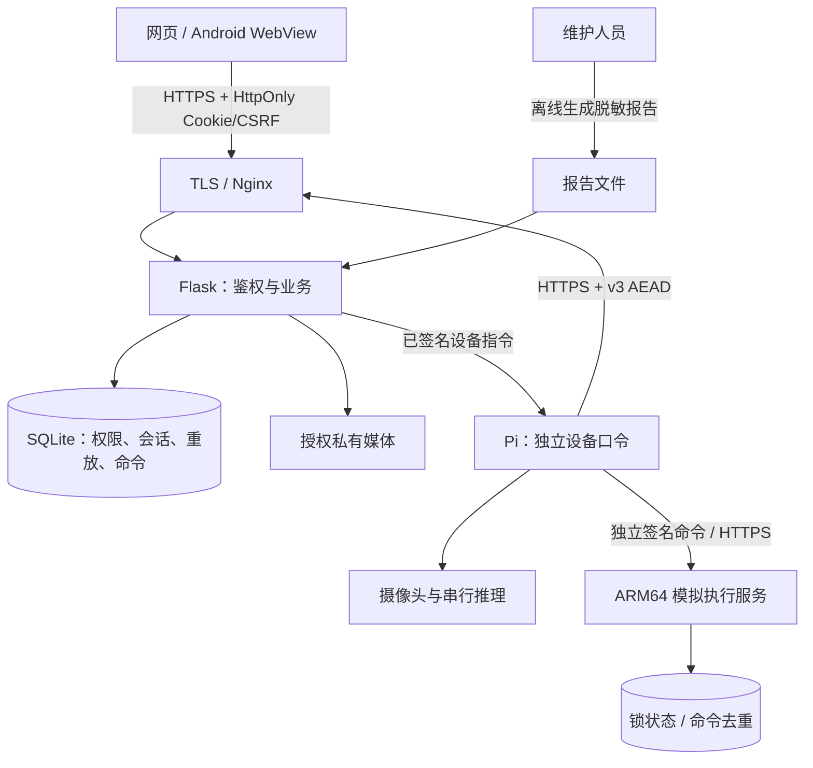
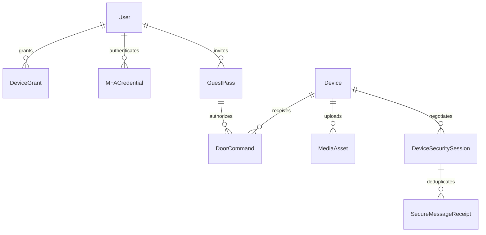
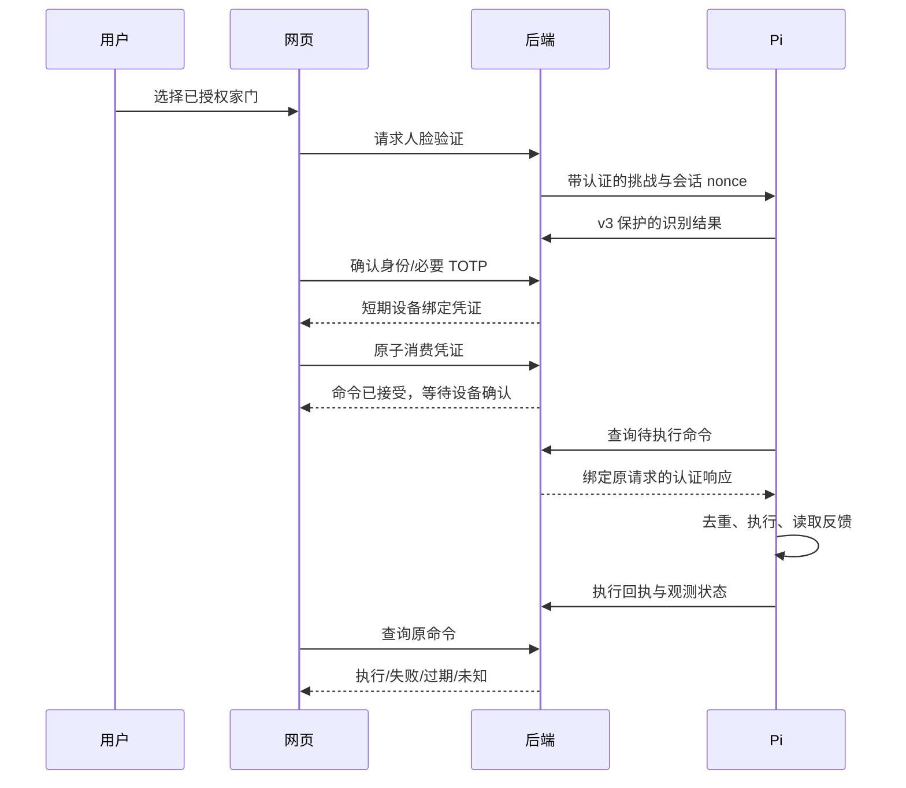
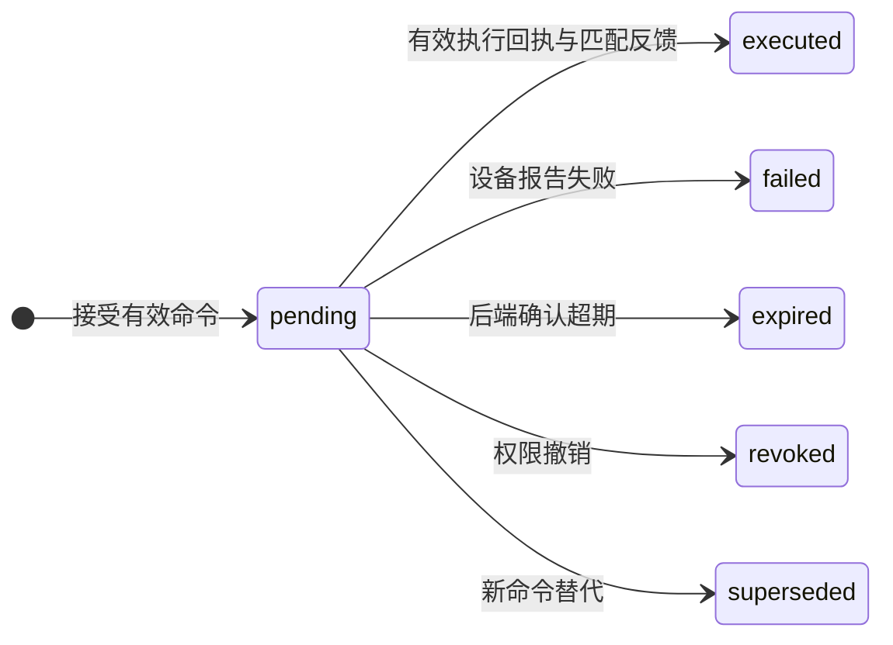

# 系统架构

SmartLock 采用模块化单体后端、独立设备服务和共享协议库。参考拓扑将 API、Web 与模拟执行器运行在电脑上，将相机与识别运行在树莓派上；Android 与 Web 使用同一业务接口。

## 组件边界

| 组件            | 内部职责与依赖                                                                 |
| --------------- | ------------------------------------------------------------------------------ |
| API             | 工厂装配扩展与路由；路由调用业务服务；模型与业务依赖未绑定扩展，不反向依赖路由 |
| Web             | `app` 装配路由和跨页会话；`features` 处理业务；`shared` 不依赖业务页面         |
| Android         | 原生连接设置、来源校验和页面生命周期；认证、权限与门控由后端执行               |
| Device          | 串行相机/推理资源、协议会话、命令去重和执行器适配                              |
| Lock simulator  | 独立 HTTP 认证、状态事务与执行记录；无用户授权签发能力                         |
| Shared protocol | 双端通信格式和密码算法；不依赖应用框架或应用内部模块                           |

组件入口由 `workspace.toml` 声明。跨组件接口通过共享协议和 HTTP 契约演进，应用不得引用另一应用的内部实现或测试夹具。

## 系统与信任边界

浏览器提交的角色、设备 ID、认证通过标记都不能成为授权依据。设备身份来自握手凭据与认证信封。数据库是多 worker 之间的唯一重放与命令事实来源。网页不访问私钥与人脸模板目录，也不能启动任意命令。远程设备指令的 HMAC 保护身份、路径、时间和内容；远程部署还需为设备服务配置受信 HTTPS，不把 HMAC 当隐私加密。

## 关键关系

图表达业务关系；设备 ID 与历史审计关联存在允许空值的兼容字段，不意味着旧记录自动具有外键完整性。

## 认证与开门时序

网络丢失时不重签发访客凭证，不把消息发送成功当作开门成功。命令状态机如下；网页观察超时是“未知”，不会凭本机时钟替后端判定已过期。

## 设计约束

- 后端以 SQLite 事务、条件更新和唯一约束处理授权消费、重放与指令状态；业务层统一提交事务，worker 启动不执行数据库迁移。
- 设备使用一个 Gunicorn worker，命令轮询与心跳独立运行，采集与模型操作串行化。每个设备维护独立持久状态，避免重启后重复执行。
- 共享协议通过同一 Python 包分发。生产仅使用 v3，客户端重启重新协商会话；v2 和实验算法保留为独立回归基线。
- 客户端仅展示状态与发起业务操作。离线验证报告由维护工具生成，管理页面只读展示。
- 当前拓扑将后端与设备分开部署，未验证低内存树莓派上的全服务共机运行。

会话、私有媒体、密钥生命周期和密码协议限制见[安全基线](security.md)。执行重试与反馈语义见[设备运行契约](reference/device-protocol.md)，环境与检查命令见[开发指南](development.md)。
